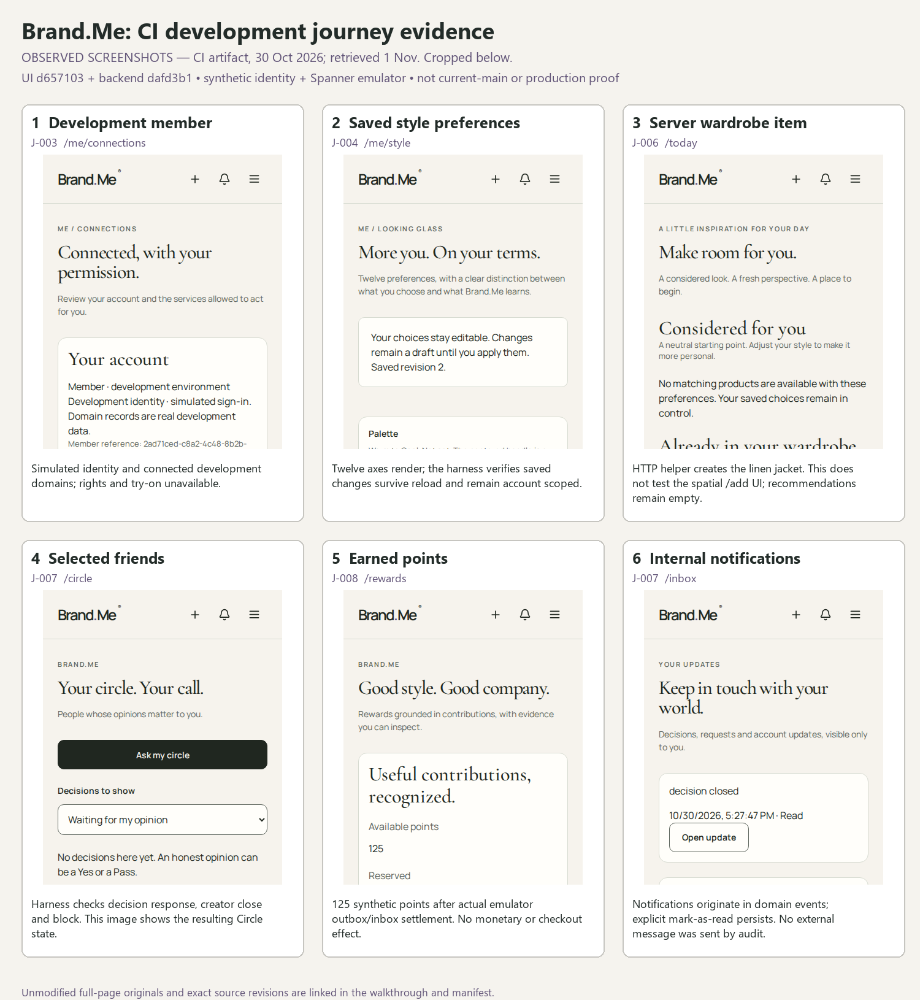

# Observed CI development journeys

[Audit index](README.md) · [Journey traces](USER_FLOWS.md) · [Browsable walkthrough](visuals/index.html)

Six **OBSERVED SCREENSHOTS — CI artifact** were retrieved and visually inspected during this audit. They provide real development execution evidence for a historical combination of revisions. They are not fresh audit captures, current-main acceptance evidence, or production/provider observations.

| Provenance | Exact scope |
|---|---|
| CI | [Run 41098774318, live-domains job 124211331191](https://github.com/brandmeonline/Brand-Me-Labs/actions/runs/41098774318/job/124211331191), success |
| UI checkout | PR merge `d657103ee21674ef14d6182572a78d75d0241b29`; parents main `ed19dc151d103b108cf972e6d37971c55d5dcf60` and PR #66 `babb3604ae2f33018edf0ad45270887d4b01945b` |
| Backend checkout | Separate pinned `dafd3b169da777ec3e3a7fc2c3f0cab573358e2b`, selected by `BRANDME_DOMAIN_REFERENCE` |
| Environment | Ubuntu 24.04 GitHub runner, development identity, real HTTP, Spanner emulator 1.5.28; synthetic members |
| Time | Job started 2026-10-30 17:26:04 UTC; artifact created 17:28:07 UTC; job completed 17:28:12 UTC. Exact per-image capture times unavailable. |
| Viewport | 390 × 844 browser viewport; full-page screenshots have greater image height |
| Artifact | `12998005788`, `live-consumer-ui-d657103ee21674ef14d6182572a78d75d0241b29`; SHA-256 `d33f7d1feda53dbe862c84ef60501962db984ecc8f9447a9ce1ae4c28d71d533` verified against downloaded archive |

Sources: [workflow at tested merge](https://github.com/brandmeonline/Brand-Me-Labs/blob/d657103ee21674ef14d6182572a78d75d0241b29/.github/workflows/consumer-ui.yml), [browser harness](https://github.com/brandmeonline/Brand-Me-Labs/blob/d657103ee21674ef14d6182572a78d75d0241b29/brandme-frontend/lib/testing/verify-live-domains.mjs), [artifact metadata](evidence/ci-artifacts-metadata.json), [sanitized provenance](evidence/ci-visual-provenance.json), [unmodified result JSON](evidence/ci-live-results.json), [per-image manifest](visuals/screenshot-manifest.json).

## What this run supports

The harness and successful result document ten checks: anonymous domain reads rejected; two distinct persisted development members; explicit guest migration with idempotent replay; twelve persona axes with saved preference/reload/account isolation; a server wardrobe item displayed on Today; persisted five-minute social decision with independent response and creator close; outbox/inbox reward settlement without duplicate points; persisted notification read; block removing the other member's decision access; and sign-out revoking the session. These correspond to parts of J-003/004/006/007/008/016. The actual result text is preserved in the linked JSON.

The wardrobe item is inserted through a direct HTTP helper before the browser displays it. This **does not verify the spatial `/add` → authenticated wardrobe journey** (F-ARCH-006). “Live” in the job name means real development HTTP and emulator persistence. Identity remains simulated; no real merchant, payment, external notification, wallet signature or production database is involved. The screenshots were taken before the final block and sign-out checks; those outcomes are recorded by assertions, not pictured. The result string “all routes” refers to the harness's enumerated routes, not every repository endpoint.

**The service composition is also test-specific.** [dev-domains.py at the tested merge](https://github.com/brandmeonline/Brand-Me-Labs/blob/d657103ee21674ef14d6182572a78d75d0241b29/brandme-frontend/lib/testing/dev-domains.py#L53-L97) supplies a development principal relay, mounts domain routers directly and dispatches outbox events straight to `RewardsConsumer.handle` in an in-process thread. Domain logic and Spanner persistence are real in this harness; canonical `persona.app`, Pub/Sub ingress and scheduled-job deployment are not exercised. Matching the UI/backend SHA in a future run is necessary but insufficient: milestone acceptance must also use the actual composed service/worker entrypoints. This is why the successful CI reward result does not resolve F-ARCH-002.

## What failed in the same run

The separate [shell job 124211331023](https://github.com/brandmeonline/Brand-Me-Labs/actions/runs/41098774318/job/124211331023) completed its component/security, build and browser steps, then failed **Compare reviewed visual baselines**: `Error: consumer-1440x900-light.png: dimensions changed` (exit 1). This is a confirmed failed visual gate. The audit did not establish whether the changed dimensions are intended; reviewing the diff is required before accepting a replacement baseline. It is not evidence that every development journey failed.

## Remaining visual verification

Run the canonical integrated commit in a disposable environment; capture full browser-created item intake, refresh/relogin, mobile and desktop layouts, keyboard/focus/contrast/reduced motion, permission denial, missing configuration, provider failure and recovery. Retain screenshots tied to one UI/backend SHA and deployment digest. No runtime failure is attributed to this host: the application was not started because adequate isolation was unavailable.
