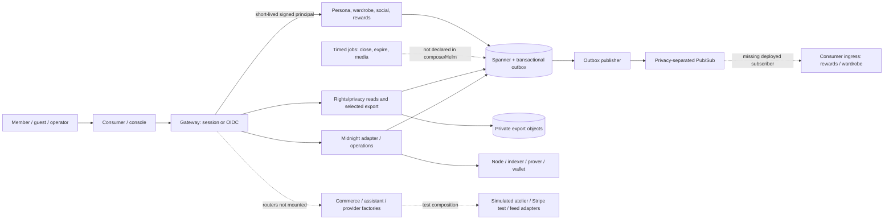

# Product, architecture and connectivity

Audit date: 2026-11-01. Auditor: Codex, architecture/connectivity reviewer. This report concerns **brandmeonline/Brand-Me-Labs only**. The canonical audit tree is remote `main@ed19dc151d103b108cf972e6d37971c55d5dcf60`. The user's original clean local `main@0f5f58a9eecaca46b367c9bd96f89654343fa5fb` is a separate older baseline. No source, branches or shared environments were changed.

The repository contains a substantial consumer-domain and trust platform, but its runtime composition stops short of the intended consumer loop. The highest-value next work is to connect and verify existing domains. Rewriting the stack would discard useful transaction, privacy, authority and asset work without fixing the missing composition boundaries.

## Intent and authority

Brand.Me is intended to be a consumer-controlled fashion identity and wardrobe: an editable style persona, possessions and aspirations, outfits, trusted social decisions, useful participation rewards, bounded shopping assistance and privacy-preserving garment rights. The person owns the relationship; retailer accounts and blockchain plumbing are supporting services. This is an inference from the explicit October 5 product contract, not a claim of market validation. The contract requires no wallet, body scan, contact import, public post or purchase before first value. [docs/design/brandme/README.md:5](https://github.com/brandmeonline/Brand-Me-Labs/blob/ed19dc151d103b108cf972e6d37971c55d5dcf60/docs/design/brandme/README.md#L5-L15) [docs/design/brandme/README.md:33](https://github.com/brandmeonline/Brand-Me-Labs/blob/ed19dc151d103b108cf972e6d37971c55d5dcf60/docs/design/brandme/README.md#L33-L63)

Actors are guests, signed-in members, invited friends/share recipients, delegated shopping agents, brand/retailer providers, creators/issuers/manufacturers and stronger-authenticated operators. These actors carry different authority: preferences are member-editable; reward balances, receipts, ownership and provenance require named authorities. Saved, ordered, physically possessed, verified and licensed items must stay distinct. [docs/design/brandme/01-product-experience.md:18](https://github.com/brandmeonline/Brand-Me-Labs/blob/ed19dc151d103b108cf972e6d37971c55d5dcf60/docs/design/brandme/01-product-experience.md#L18-L38) [docs/design/brandme/README.md:45](https://github.com/brandmeonline/Brand-Me-Labs/blob/ed19dc151d103b108cf972e6d37971c55d5dcf60/docs/design/brandme/README.md#L45-L56)

The October 5 specification supersedes the older narrow trust-first PLAN sequence for **product behavior**. Its technology versions, numerical UX targets, reward values, retention and acceptance thresholds are proposed engineering defaults. They are not measured readiness or partner promises. The machine-readable catalog has **150 acceptance requirements**, explicitly marked requirements rather than results; stage counts and every original ID are in [requirements-inventory.json](evidence/requirements-inventory.json). No pass percentage is inferred. [docs/design/brandme/README.md:33](https://github.com/brandmeonline/Brand-Me-Labs/blob/ed19dc151d103b108cf972e6d37971c55d5dcf60/docs/design/brandme/README.md#L33-L42) [docs/design/brandme/contracts/acceptance-catalog.json:1](https://github.com/brandmeonline/Brand-Me-Labs/blob/ed19dc151d103b108cf972e6d37971c55d5dcf60/docs/design/brandme/contracts/acceptance-catalog.json#L1-L13)

`CLAUDE.md` remains useful for security/honesty instructions but is no longer a reliable overall runtime map: its old claims that only consent/provenance exist and frontend is unconnected conflict with current mounted consumer routers and compose. Persona/provider READMEs still say no logic where substantial modules now exist. Conversely older enterprise-readiness claims are not evidence. This contradiction is F-ARCH-005, not a reason to privilege one stale document over code. [CLAUDE.md:28](https://github.com/brandmeonline/Brand-Me-Labs/blob/ed19dc151d103b108cf972e6d37971c55d5dcf60/CLAUDE.md#L28-L60) [brandme_core/domains/persona/app.py:68](https://github.com/brandmeonline/Brand-Me-Labs/blob/ed19dc151d103b108cf972e6d37971c55d5dcf60/brandme_core/domains/persona/app.py#L68-L77) [docker-compose.yml:24](https://github.com/brandmeonline/Brand-Me-Labs/blob/ed19dc151d103b108cf972e6d37971c55d5dcf60/docker-compose.yml#L24-L27)

The [150-row requirements traceability](REQUIREMENTS_TRACEABILITY.md) and [structured mapping](evidence/requirement-traceability.json) link every acceptance ID to related capability and entrypoint evidence, with explicit missing verification. These are coarse inferred associations: no requirement-specific acceptance verdict is assigned, and mapping completeness is not test or exhaustive implementation-review completeness.

## Canonical architecture and revision boundaries

The current canonical public boundary is `brandme-gateway/src/index.ts` and its `routes/v1/index.ts` mount list; actual consumers and registration outrank directory names. Consumer domains are implemented in a separate FastAPI process under `brandme_core/domains/persona/app.py` on port 8010. That differs from the original contract's suggestion to mount domains inside brain. The separation is understandable because legacy brain is explicitly prohibited in strict modes by its synthetic trust path, while the new consumer service has a scoped principal-assertion boundary. It should be recorded as an architecture decision instead of hiding it behind an old service map. [docs/design/brandme/03-architecture-data-api.md:7](https://github.com/brandmeonline/Brand-Me-Labs/blob/ed19dc151d103b108cf972e6d37971c55d5dcf60/docs/design/brandme/03-architecture-data-api.md#L7-L16) [brandme-core/brain/main.py:11](https://github.com/brandmeonline/Brand-Me-Labs/blob/ed19dc151d103b108cf972e6d37971c55d5dcf60/brandme-core/brain/main.py#L11-L16) [brandme_core/domains/persona/app.py:46](https://github.com/brandmeonline/Brand-Me-Labs/blob/ed19dc151d103b108cf972e6d37971c55d5dcf60/brandme_core/domains/persona/app.py#L46-L84)

At the original local SHA, `brandme_core/domains`, `packages` and `brandme_core/privacy_exports` do not exist in Git's tree listing. Those capabilities belong to the newer remote main, not the user's old checkout. See the saved `git ls-tree` result in [reference searches](evidence/architecture-reference-searches.json). No local-checkout runtime test is inferred from main CI or branch work.

The intended architecture is browser/console → gateway identity → domain transactions in Spanner → durable workers → provider/chain side effects and private projections/media. Firestore is a replaceable projection; Cloud Run was the initial target for ordinary HTTP and event work. Current deployment declarations use a GKE Helm chart. Its README explicitly attributes this option to a founder request and records the tension with the original Cloud Run ADR. Preserve that decision and verify its operating cost/capacity assumptions; the chart is not evidence of a running cluster. [docs/design/brandme/03-architecture-data-api.md:10](https://github.com/brandmeonline/Brand-Me-Labs/blob/ed19dc151d103b108cf972e6d37971c55d5dcf60/docs/design/brandme/03-architecture-data-api.md#L10-L18) [brandme-infra/helm/brandme/README.md:3](https://github.com/brandmeonline/Brand-Me-Labs/blob/ed19dc151d103b108cf972e6d37971c55d5dcf60/brandme-infra/helm/brandme/README.md#L3-L11)

This is an **implemented-code connectivity view**, not deployment evidence. For a rendered system diagram and proposed/observed visuals see [USER_FLOWS.md](USER_FLOWS.md) and [visuals](visuals/). The independently observed deployment view is **unknown**: declarations, committed local-network chain evidence and CI build checks do not identify a current production deployment, its SHA or its resource permissions. [INTEGRATIONS_INFRASTRUCTURE.md](INTEGRATIONS_INFRASTRUCTURE.md) records the declared/applied distinction.

## Capability traceability

Every row below is remote main at `ed19dc151d103b108cf972e6d37971c55d5dcf60`. Full intended outcomes, authoritative chapter/date, paths, evidence and missing boundaries are preserved in [capabilities.json](evidence/capabilities.json). “Implemented” describes source behavior, not successful execution. “Connected” means a discoverable source registration exists; configured deployment and meaningful external effects remain separate.

| ID | Outcome and role | Main implementation / entry | Five separate axes | Missing link |
|---|---|---|---|---|
| CAP-001 | Identity and account sessions — guest/member/operator | [brandme-gateway/src/routes/v1/index.ts:85](https://github.com/brandmeonline/Brand-Me-Labs/blob/ed19dc151d103b108cf972e6d37971c55d5dcf60/brandme-gateway/src/routes/v1/index.ts#L85-L129); Gateway /api/v1/session/dev, /session and /me; real OIDC via principal middleware | Implementation: partial; wiring: connected; verification: static evidence; deployment: unknown; fit: partial match | Dev session is explicitly simulated; managed login/recovery and console stronger identity must be validated in a configured environment. |
| CAP-002 | Editable Looking Glass persona — member | [brandme_core/domains/persona/app.py:68](https://github.com/brandmeonline/Brand-Me-Labs/blob/ed19dc151d103b108cf972e6d37971c55d5dcf60/brandme_core/domains/persona/app.py#L68-L75); Gateway persona router → signed assertion → PersonaService → Spanner | Implementation: implemented; wiring: connected; verification: static evidence; deployment: unknown; fit: matches intent | Browser journey and deployed service not executed by this audit; guest and server state must remain visibly distinct. |
| CAP-003 | Explainable, wardrobe-aware recommendations — member | [brandme_core/domains/persona/app.py:68](https://github.com/brandmeonline/Brand-Me-Labs/blob/ed19dc151d103b108cf972e6d37971c55d5dcf60/brandme_core/domains/persona/app.py#L68-L71); GET persona recommendations / preview → recommend(candidate_source(principal), request) | Implementation: partial; wiring: partly connected; verification: static evidence; deployment: unknown; fit: partial match | F-ARCH-003: application composition supplies neither catalog candidates nor wardrobe refs; defaults are empty. |
| CAP-004 | Durable wardrobe intake and item lifecycle — member | [brandme_core/domains/persona/app.py:70](https://github.com/brandmeonline/Brand-Me-Labs/blob/ed19dc151d103b108cf972e6d37971c55d5dcf60/brandme_core/domains/persona/app.py#L70-L74); Gateway wardrobe routes → WardrobeService → Spanner V003 | Implementation: implemented; wiring: connected; verification: static evidence; deployment: unknown; fit: matches intent | Configured emulators/DB/schema/assertion keys needed; actual UI-to-DB persistence unexecuted here. |
| CAP-005 | Spatial wardrobe and placement — member/guest | [brandme_core/domains/wardrobe/service.py:660](https://github.com/brandmeonline/Brand-Me-Labs/blob/ed19dc151d103b108cf972e6d37971c55d5dcf60/brandme_core/domains/wardrobe/service.py#L660-L831); Frontend /closet; domain layout/placement methods | Implementation: partial; wiring: partly connected; verification: static evidence; deployment: unknown; fit: partial match | F-ARCH-006: only guest IndexedDB ClosetRepository is supplied; strict-mode gate blocks the route. Connect authenticated server wardrobe/layout contracts. |
| CAP-006 | Versioned outfits, collaboration and packing — member/friend | [brandme_core/domains/persona/app.py:70](https://github.com/brandmeonline/Brand-Me-Labs/blob/ed19dc151d103b108cf972e6d37971c55d5dcf60/brandme_core/domains/persona/app.py#L70-L74); Gateway outfits router → OutfitService with friendship_proposal_policy | Implementation: implemented; wiring: connected; verification: static evidence; deployment: unknown; fit: matches intent | Cross-member browser and persistence behavior requires isolated journey execution. |
| CAP-007 | Friends, shares and five-minute decisions — member/friend/recipient | [brandme_core/domains/persona/app.py:73](https://github.com/brandmeonline/Brand-Me-Labs/blob/ed19dc151d103b108cf972e6d37971c55d5dcf60/brandme_core/domains/persona/app.py#L73-L74); Gateway social/decisions → Social services; jobs closes due decisions | Implementation: partial; wiring: partly connected; verification: static evidence; deployment: unknown; fit: partial match | F-ARCH-002: close_due job has executable module but no compose/Helm startup; no observed scheduler. |
| CAP-008 | Rewards ledger, badges and benefits — member/operator | [brandme_core/domains/rewards/consumer.py:43](https://github.com/brandmeonline/Brand-Me-Labs/blob/ed19dc151d103b108cf972e6d37971c55d5dcf60/brandme_core/domains/rewards/consumer.py#L43-L71); Gateway rewards → Spanner; Pub/Sub consumer awards; jobs expires reservations | Implementation: partial; wiring: partly connected; verification: static evidence; deployment: unknown; fit: partial match | F-ARCH-002: subscription consumer/jobs absent from deploy composition; partner fulfillment intentionally not configured. |
| CAP-009 | Catalog, retailer tiers and provider setup — member/operator | [brandme_core/domains/providers/nordstrom.py:1](https://github.com/brandmeonline/Brand-Me-Labs/blob/ed19dc151d103b108cf972e6d37971c55d5dcf60/brandme_core/domains/providers/nordstrom.py#L1); Provider/domain factories and unmounted gateway router; test harnesses | Implementation: partial; wiring: unreachable; verification: static evidence; deployment: unknown; fit: partial match | F-ARCH-001 plus provider agreements/feed rights/resource setup. Strict commerce registry is empty. |
| CAP-010 | Bounded checkout, payment and reconciliation — member/delegated agent | [brandme-gateway/src/routes/v1/commerce.ts:204](https://github.com/brandmeonline/Brand-Me-Labs/blob/ed19dc151d103b108cf972e6d37971c55d5dcf60/brandme-gateway/src/routes/v1/commerce.ts#L204-L269); Unregistered commerce gateway factory; Python FastAPI factory consumed by tests | Implementation: partial; wiring: unreachable; verification: static evidence; deployment: unknown; fit: partial match | F-ARCH-001: compose real service entry, contract and webhook mounting; no real contracted merchant registered; Stripe test is not live retail. |
| CAP-011 | Shopping assistant and MCP authority — member/delegated agent | [brandme-gateway/src/routes/v1/assistant.ts:27](https://github.com/brandmeonline/Brand-Me-Labs/blob/ed19dc151d103b108cf972e6d37971c55d5dcf60/brandme-gateway/src/routes/v1/assistant.ts#L27); Assistant/MCP domain objects plus unmounted gateway factory; no discoverable public MCP transport found | Implementation: partial; wiring: unreachable; verification: static evidence; deployment: unknown; fit: partial match | F-ARCH-001; durable assistant task/budget/audit stores and job queue remain required; current dev model is not a production integration. |
| CAP-012 | Media upload and photo try-on — member | [brandme_core/domains/persona/app.py:21](https://github.com/brandmeonline/Brand-Me-Labs/blob/ed19dc151d103b108cf972e6d37971c55d5dcf60/brandme_core/domains/persona/app.py#L21-L28); Gateway media/tryon routes; consumer mounts only with media_store | Implementation: partial; wiring: partly connected; verification: static evidence; deployment: unknown; fit: partial match | Default compose has no bucket/store; no approved real try-on provider; jobs not deployed. Device AR/fit execution unverified. |
| CAP-013 | Midnight rights and ownership observations — member/issuer | [brandme-chain/src/index.ts:1](https://github.com/brandmeonline/Brand-Me-Labs/blob/ed19dc151d103b108cf972e6d37971c55d5dcf60/brandme-chain/src/index.ts#L1); Gateway rights/chain routes → chain service → Midnight adapter/operations; reads → Spanner projections | Implementation: partial; wiring: partly connected; verification: static evidence; deployment: unknown; fit: partial match | No deployed SHA or environment business execution observed by this audit. Owner-command surface remains incomplete on main; #70 contains additional commands. |
| CAP-014 | Ownership transfer and licensed reprint — member/recipient/manufacturer | [brandme_core/domains/rights/reprint.py:88](https://github.com/brandmeonline/Brand-Me-Labs/blob/ed19dc151d103b108cf972e6d37971c55d5dcf60/brandme_core/domains/rights/reprint.py#L88-L168); Read-only rights service and chain operations; main lacks rights command composition | Implementation: partial; wiring: partly connected; verification: static evidence; deployment: unknown; fit: partial match | Main read API returns 503 for commands. Preserve/integrate #70 rights_commands after migration collision review; manufacturer/physical attestation and disputes remain separate. |
| CAP-015 | Selected rights data export — member | [brandme_core/privacy_exports/service.py:23](https://github.com/brandmeonline/Brand-Me-Labs/blob/ed19dc151d103b108cf972e6d37971c55d5dcf60/brandme_core/privacy_exports/service.py#L23-L24); Gateway My Data export → privacy_exports API/worker → Spanner and private object store | Implementation: implemented; wiring: connected; verification: static evidence; deployment: unknown; fit: partial match | Requires configured export bucket, token, schema and worker. Five rights categories only, not full account export. |
| CAP-016 | Full-account export, deletion and recovery — member/operator | [brandme_core/read_api/reads.py:83](https://github.com/brandmeonline/Brand-Me-Labs/blob/ed19dc151d103b108cf972e6d37971c55d5dcf60/brandme_core/read_api/reads.py#L83-L86); Reusable domain privacy handlers; public inventory/read-only deletion status; main mutation route disabled | Implementation: partial; wiring: partly connected; verification: static evidence; deployment: unknown; fit: partial match | F-ARCH-004: privacy composition and all-domain export/deletion worker unmounted; do not claim complete erasure. |
| CAP-017 | Operator moderation, dispute and provider controls — operator/support | [brandme_core/domains/persona/app.py:13](https://github.com/brandmeonline/Brand-Me-Labs/blob/ed19dc151d103b108cf972e6d37971c55d5dcf60/brandme_core/domains/persona/app.py#L13-L14); Console UI and library router factories; consumer /ops routers deliberately not mounted | Implementation: partial; wiring: partly connected; verification: static evidence; deployment: unknown; fit: partial match | Establish actual operator authority and mount scoped routers; legacy governance is protected from strict startup because approver identity is not authenticated. |
| CAP-018 | Durable domain events and projections — services/operators | [brandme_core/domains/persona/kernel.py:440](https://github.com/brandmeonline/Brand-Me-Labs/blob/ed19dc151d103b108cf972e6d37971c55d5dcf60/brandme_core/domains/persona/kernel.py#L440-L468); Transaction outbox → Pub/Sub publisher → separate consumer ingress | Implementation: partial; wiring: partly connected; verification: static evidence; deployment: unknown; fit: partial match | Publishing worker is wired in Helm; consumer ingress is not. Broker acknowledgement alone is not application success. |
| CAP-019 | Legacy garment scan, policy and provenance — scanner/owner/operator | [brandme-core/brain/main.py:11](https://github.com/brandmeonline/Brand-Me-Labs/blob/ed19dc151d103b108cf972e6d37971c55d5dcf60/brandme-core/brain/main.py#L11-L16); Legacy /scan NATS publisher; brain/policy/orchestrator/cube paths | Implementation: partial; wiring: partly connected; verification: static evidence; deployment: unknown; fit: partial match | Legacy orchestrator fabricates cardano_tx string in dev and strict boot guard blocks it; do not confuse with newer Midnight service. |
| CAP-020 | Cardano public anchoring — issuer/operator | [brandme-chain/src/cardano/anchor.ts:1](https://github.com/brandmeonline/Brand-Me-Labs/blob/ed19dc151d103b108cf972e6d37971c55d5dcf60/brandme-chain/src/cardano/anchor.ts#L1); Cardano interface/no configured real anchor; legacy synthetic transfer hash | Implementation: placeholder/mock; wiring: partly connected; verification: static evidence; deployment: unknown; fit: partial match | A real adapter, network, funding, verification and privacy-safe anchor semantics remain required; optional after the consumer milestone. |

## Consequential missing boundaries

1. **F-ARCH-001 — commerce and assistant are stranded inside main.** Public route factories and a Python HTTP factory exist; canonical gateway imports do not register them, and factory/composition callers found by the reference search are tests. Strict commerce startup returns an empty provider registry. A key cannot create the missing service, durable task storage, trusted approval surface, merchant authorization or webhook mounting. [brandme-gateway/src/routes/v1/index.ts:131](https://github.com/brandmeonline/Brand-Me-Labs/blob/ed19dc151d103b108cf972e6d37971c55d5dcf60/brandme-gateway/src/routes/v1/index.ts#L131-L149) [brandme_core/domains/commerce/composition.py:102](https://github.com/brandmeonline/Brand-Me-Labs/blob/ed19dc151d103b108cf972e6d37971c55d5dcf60/brandme_core/domains/commerce/composition.py#L102-L133)
2. **F-ARCH-002 — delivery is not the domain effect.** The outbox publisher loads foundation, consumer and commerce contracts. Separate jobs and a Pub/Sub ingress implement closing decisions, earning rewards, releasing reservations, media processing and order-to-wardrobe updates, but no deployment configuration starts them. A persisted event or broker acknowledgement cannot support a claim that a user earned a reward or received an item. [brandme_core/events/catalogs.py:29](https://github.com/brandmeonline/Brand-Me-Labs/blob/ed19dc151d103b108cf972e6d37971c55d5dcf60/brandme_core/events/catalogs.py#L29-L35) [brandme_core/domains/persona/ingress.py:147](https://github.com/brandmeonline/Brand-Me-Labs/blob/ed19dc151d103b108cf972e6d37971c55d5dcf60/brandme_core/domains/persona/ingress.py#L147-L180) [brandme_core/domains/persona/jobs.py:42](https://github.com/brandmeonline/Brand-Me-Labs/blob/ed19dc151d103b108cf972e6d37971c55d5dcf60/brandme_core/domains/persona/jobs.py#L42-L65)
3. **F-ARCH-003 — recommendations have no application-supplied candidates.** `PersonaService(database)` uses the default empty catalog and wardrobe sources. The ranking algorithm is substantial reusable work, but the mounted API cannot choose real catalog/owned items until those sources are composed. [brandme_core/domains/persona/app.py:68](https://github.com/brandmeonline/Brand-Me-Labs/blob/ed19dc151d103b108cf972e6d37971c55d5dcf60/brandme_core/domains/persona/app.py#L68-L71) [brandme_core/domains/persona/service.py:128](https://github.com/brandmeonline/Brand-Me-Labs/blob/ed19dc151d103b108cf972e6d37971c55d5dcf60/brandme_core/domains/persona/service.py#L128-L141) [brandme_core/domains/persona/service.py:1132](https://github.com/brandmeonline/Brand-Me-Labs/blob/ed19dc151d103b108cf972e6d37971c55d5dcf60/brandme_core/domains/persona/service.py#L1132-L1159)
4. **F-ARCH-004 — account privacy stops at a selected rights slice.** The current read inventory explicitly says `full_account: false`; export uses five rights categories, and mutations return 503. Native consumer/commerce privacy handlers should be connected and verified, not rewritten. Preserve the honest partial-coverage labels while doing so. [brandme_core/read_api/reads.py:180](https://github.com/brandmeonline/Brand-Me-Labs/blob/ed19dc151d103b108cf972e6d37971c55d5dcf60/brandme_core/read_api/reads.py#L180-L186) [brandme_core/read_api/app.py:122](https://github.com/brandmeonline/Brand-Me-Labs/blob/ed19dc151d103b108cf972e6d37971c55d5dcf60/brandme_core/read_api/app.py#L122-L125) [brandme_core/privacy_exports/service.py:285](https://github.com/brandmeonline/Brand-Me-Labs/blob/ed19dc151d103b108cf972e6d37971c55d5dcf60/brandme_core/privacy_exports/service.py#L285-L290)
5. **F-ARCH-006 — spatial UI and server wardrobe are separate.** The only found ClosetRepository is guest IndexedDB; useCloset selects it by default, and strict modes deliberately block the screen. Retain the server wardrobe and guest renderer, then implement the authenticated repository rather than removing the safety gate first. [brandme-frontend/features/closet/repository.ts:265](https://github.com/brandmeonline/Brand-Me-Labs/blob/ed19dc151d103b108cf972e6d37971c55d5dcf60/brandme-frontend/features/closet/repository.ts#L265-L286) [brandme-frontend/features/closet/useCloset.ts:10](https://github.com/brandmeonline/Brand-Me-Labs/blob/ed19dc151d103b108cf972e6d37971c55d5dcf60/brandme-frontend/features/closet/useCloset.ts#L10-L12) [brandme-frontend/features/closet/SpatialModeGate.tsx:12](https://github.com/brandmeonline/Brand-Me-Labs/blob/ed19dc151d103b108cf972e6d37971c55d5dcf60/brandme-frontend/features/closet/SpatialModeGate.tsx#L12-L23)

Developer startup also differs by command: `scripts/brandme.mjs` starts brain, gateway and consumer UI only; it never starts the consumer-domain service on 8010 or the jobs/ingress. Docker Compose now includes consumer domains but requires a separately generated assertion key pair and excludes media storage. Neither entrypoint currently assembles the complete timed social/reward milestone. [scripts/brandme.mjs:169](https://github.com/brandmeonline/Brand-Me-Labs/blob/ed19dc151d103b108cf972e6d37971c55d5dcf60/scripts/brandme.mjs#L169-L190) [docker-compose.yml:17](https://github.com/brandmeonline/Brand-Me-Labs/blob/ed19dc151d103b108cf972e6d37971c55d5dcf60/docker-compose.yml#L17-L27) [docker-compose.yml:188](https://github.com/brandmeonline/Brand-Me-Labs/blob/ed19dc151d103b108cf972e6d37971c55d5dcf60/docker-compose.yml#L188-L211)

**F-ARCH-007 — legacy regional policy is dormant.** The region YAML loader exists, but repository references do not connect it to the policy endpoint. That endpoint checks two hardcoded blocked-region literals and then consent. Do not infer legal/regional policy enforcement from the YAML or the old map. The strict-mode guard limits this legacy path; retaining its regional promise requires reviewed rule injection and fail-closed configuration, or explicit retirement after a replacement. [brandme-core/policy/main.py:30](https://github.com/brandmeonline/Brand-Me-Labs/blob/ed19dc151d103b108cf972e6d37971c55d5dcf60/brandme-core/policy/main.py#L30-L31) [brandme-core/policy/main.py:101](https://github.com/brandmeonline/Brand-Me-Labs/blob/ed19dc151d103b108cf972e6d37971c55d5dcf60/brandme-core/policy/main.py#L101-L116) [brandme-core/policy/main.py:139](https://github.com/brandmeonline/Brand-Me-Labs/blob/ed19dc151d103b108cf972e6d37971c55d5dcf60/brandme-core/policy/main.py#L139-L157) [brandme-core/policy/region_rules.py:33](https://github.com/brandmeonline/Brand-Me-Labs/blob/ed19dc151d103b108cf972e6d37971c55d5dcf60/brandme-core/policy/region_rules.py#L33-L69)

Detailed impact, preconditions, remediation dependencies, effort assumptions and objective acceptance checks are in [findings-architecture.json](evidence/findings-architecture.json); implementation work packages are reconciled in [ROADMAP.md](ROADMAP.md).

## Component decisions and duplication

The complete component inventory includes responsibility, runtime, entry point, inbound consumers, outbound dependencies, source evidence, overlap, product value and confidence in [components.json](evidence/components.json). Components are assessed by registration and consumers, not import count alone.

| ID | Component / entry and consumers | Recommendation / rationale |
|---|---|---|
| CMP-001 | Consumer application — App Router / routes; consumers: Browser | **retain/connect**. Legacy placeholder components coexist; root owns UI review [pnpm-workspace.yaml:6](https://github.com/brandmeonline/Brand-Me-Labs/blob/ed19dc151d103b108cf972e6d37971c55d5dcf60/pnpm-workspace.yaml#L6-L12) |
| CMP-002 | Operator console — App Router operator routes; consumers: Operators | **retain/repair**. Must not inherit legacy unauthenticated governance approval [docs/design/brandme/03-architecture-data-api.md:58](https://github.com/brandmeonline/Brand-Me-Labs/blob/ed19dc151d103b108cf972e6d37971c55d5dcf60/docs/design/brandme/03-architecture-data-api.md#L58) |
| CMP-003 | Public gateway — src/index.ts createApp/start; consumers: Browser/BFF/agents | **retain/connect**. brandme_gateway alternate path and unmounted commerce routers [brandme-gateway/src/index.ts:30](https://github.com/brandmeonline/Brand-Me-Labs/blob/ed19dc151d103b108cf972e6d37971c55d5dcf60/brandme-gateway/src/index.ts#L30-L98) |
| CMP-004 | Consumer domain HTTP composition — python -m brandme_core.domains.persona.app; consumers: Gateway DomainClient | **retain/repair**. Design originally said brain modules; this is now a separate service [brandme_core/domains/persona/app.py:46](https://github.com/brandmeonline/Brand-Me-Labs/blob/ed19dc151d103b108cf972e6d37971c55d5dcf60/brandme_core/domains/persona/app.py#L46-L84) |
| CMP-005 | Persona domain — PersonaService and create_persona_router; consumers: Consumer app, guest migration, tests | **retain/connect**. README says reserved but implementation is substantial [brandme_core/domains/persona/service.py:128](https://github.com/brandmeonline/Brand-Me-Labs/blob/ed19dc151d103b108cf972e6d37971c55d5dcf60/brandme_core/domains/persona/service.py#L128-L141) |
| CMP-006 | Wardrobe and outfits — WardrobeService / OutfitService; consumers: Consumer app; commerce event subscriber | **retain/connect**. Legacy Firestore wardrobe is a separate authority; do not dual-write blindly [brandme_core/domains/persona/app.py:70](https://github.com/brandmeonline/Brand-Me-Labs/blob/ed19dc151d103b108cf972e6d37971c55d5dcf60/brandme_core/domains/persona/app.py#L70-L74) |
| CMP-007 | Social domains — create_social_router; Relationship/Decision/Share services; consumers: Consumer app; jobs | **retain/connect**. Branch #66 adds houses/rooms/flow; do not assume merged [brandme_core/domains/persona/app.py:73](https://github.com/brandmeonline/Brand-Me-Labs/blob/ed19dc151d103b108cf972e6d37971c55d5dcf60/brandme_core/domains/persona/app.py#L73-L74) |
| CMP-008 | Rewards — create_rewards_router, RewardsConsumer; consumers: Consumer app; LaneSubscriber | **retain/connect**. No partner benefit fulfilment and no deployed ingress/jobs [brandme_core/domains/rewards/consumer.py:43](https://github.com/brandmeonline/Brand-Me-Labs/blob/ed19dc151d103b108cf972e6d37971c55d5dcf60/brandme_core/domains/rewards/consumer.py#L43-L71) |
| CMP-009 | Media and try-on — Conditional create_media_router; MediaService; consumers: Consumer app and jobs | **retain/connect**. Only simulated photo provider; overlay is not calibrated fit [brandme_core/domains/persona/app.py:21](https://github.com/brandmeonline/Brand-Me-Labs/blob/ed19dc151d103b108cf972e6d37971c55d5dcf60/brandme_core/domains/persona/app.py#L21-L28) |
| CMP-010 | Consumer scheduled jobs — python -m ...persona.jobs [--once]; consumers: No declared compose/Helm caller found | **connect**. Separate from outbox publisher [brandme_core/domains/persona/jobs.py:42](https://github.com/brandmeonline/Brand-Me-Labs/blob/ed19dc151d103b108cf972e6d37971c55d5dcf60/brandme_core/domains/persona/jobs.py#L42-L65) |
| CMP-011 | Consumer event ingress — python -m ...persona.ingress; consumers: No declared compose/Helm caller found | **connect**. Publisher success does not mean this ran [brandme_core/domains/persona/ingress.py:147](https://github.com/brandmeonline/Brand-Me-Labs/blob/ed19dc151d103b108cf972e6d37971c55d5dcf60/brandme_core/domains/persona/ingress.py#L147-L180) |
| CMP-012 | Foundation domain framework — Principal, authorize, run_command, run_idempotent_command; consumers: Consumer domains and other services | **retain**. Consumer kernel adds retries; commerce intentionally scopes its own idempotency [brandme_core/domains/persona/kernel.py:38](https://github.com/brandmeonline/Brand-Me-Labs/blob/ed19dc151d103b108cf972e6d37971c55d5dcf60/brandme_core/domains/persona/kernel.py#L38-L55) |
| CMP-013 | Commerce domain — CommerceService; create_commerce_app factory; consumers: Only test composition currently found | **retain/connect**. No mounted public runtime; no real strict-mode merchant registry [brandme_core/domains/commerce/http_api.py:638](https://github.com/brandmeonline/Brand-Me-Labs/blob/ed19dc151d103b108cf972e6d37971c55d5dcf60/brandme_core/domains/commerce/http_api.py#L638-L670) |
| CMP-014 | Provider adapters — ProviderRegistry/build_providers; setup/tiers/ingestion; consumers: Commerce domain tests/factories | **retain/connect**. Catalog/affiliate entitlement is distinct from checkout rights [brandme_core/domains/commerce/composition.py:90](https://github.com/brandmeonline/Brand-Me-Labs/blob/ed19dc151d103b108cf972e6d37971c55d5dcf60/brandme_core/domains/commerce/composition.py#L90-L133) |
| CMP-015 | Assistant runtime — AssistantRuntime + compose_assistant; consumers: CommerceHttpApi/test harness | **retain/connect**. Tasks/budgets/audit in dev form require durability; separate from legacy orchestrator service [brandme_core/domains/commerce/README.md:27](https://github.com/brandmeonline/Brand-Me-Labs/blob/ed19dc151d103b108cf972e6d37971c55d5dcf60/brandme_core/domains/commerce/README.md#L27-L52) |
| CMP-016 | MCP tool executor — McpToolExecutor.invoke/call; consumers: Assistant runtime/tests | **retain/connect**. Not evidence of a mounted external MCP server [brandme_core/mcp/tools.py:220](https://github.com/brandmeonline/Brand-Me-Labs/blob/ed19dc151d103b108cf972e6d37971c55d5dcf60/brandme_core/mcp/tools.py#L220-L265) |
| CMP-017 | Outbox, inbox and projection framework — python -m brandme_core.events.worker; consumers: Helm events-worker; domain writers | **retain/connect**. Lane wrapper outbox_worker now redundant because catalogs load all lanes [brandme_core/events/worker.py:71](https://github.com/brandmeonline/Brand-Me-Labs/blob/ed19dc151d103b108cf972e6d37971c55d5dcf60/brandme_core/events/worker.py#L71-L109) |
| CMP-018 | Redundant lane outbox wrapper — python -m ...persona.outbox_worker; consumers: No current startup consumer found | **removal candidate after reference recheck**. Foundation now loads same domain catalog; do not delete in audit [brandme_core/domains/persona/outbox_worker.py:1](https://github.com/brandmeonline/Brand-Me-Labs/blob/ed19dc151d103b108cf972e6d37971c55d5dcf60/brandme_core/domains/persona/outbox_worker.py#L1-L30) |
| CMP-019 | Read API — python -m brandme_core.read_api; consumers: Gateway rights and privacy client | **retain/connect**. Rights-only privacy catalog; mutation routes 503 [brandme_core/read_api/app.py:57](https://github.com/brandmeonline/Brand-Me-Labs/blob/ed19dc151d103b108cf972e6d37971c55d5dcf60/brandme_core/read_api/app.py#L57-L127) |
| CMP-020 | Export API and worker — python -m brandme_core.privacy_exports [--worker]; consumers: Gateway; Helm exports API/worker | **retain/extend**. Does not call all-domain handlers; explicit full_account=false [brandme_core/privacy_exports/service.py:23](https://github.com/brandmeonline/Brand-Me-Labs/blob/ed19dc151d103b108cf972e6d37971c55d5dcf60/brandme_core/privacy_exports/service.py#L23-L24) |
| CMP-021 | Privacy domain and erasure handlers — PrivacyService, PrivacyRegistry, per-domain handlers; consumers: Tests and registered libraries; current public mutation unmounted | **retain/connect**. Do not substitute rights-only export for all-domain coverage [brandme_core/domains/privacy/privacy.py:240](https://github.com/brandmeonline/Brand-Me-Labs/blob/ed19dc151d103b108cf972e6d37971c55d5dcf60/brandme_core/domains/privacy/privacy.py#L240-L276) |
| CMP-022 | Rights projection and reprint ledger — apply_observation/read_claims/ReprintLedger; consumers: Read API/tests/chain observation interface | **retain/connect**. Rights commands composition exists only on #70 [brandme_core/domains/rights/projection.py:50](https://github.com/brandmeonline/Brand-Me-Labs/blob/ed19dc151d103b108cf972e6d37971c55d5dcf60/brandme_core/domains/rights/projection.py#L50-L70) |
| CMP-023 | Midnight chain service and Compact contract — src/index.ts; /midnight and operations; consumers: Gateway rights client; chain operators | **retain/verify**. Legacy chain implementation replaced; Cardano is separate unavailable adapter [brandme-chain/src/index.ts:1](https://github.com/brandmeonline/Brand-Me-Labs/blob/ed19dc151d103b108cf972e6d37971c55d5dcf60/brandme-chain/src/index.ts#L1) |
| CMP-024 | Legacy brain — main.py /intent/resolve, /health; consumers: Legacy scan flow; gateway smoke | **retain as legacy/repair before promotion**. Not the new consumer-domain composition; strict guard refuses fabricated trust path [brandme-core/brain/main.py:11](https://github.com/brandmeonline/Brand-Me-Labs/blob/ed19dc151d103b108cf972e6d37971c55d5dcf60/brandme-core/brain/main.py#L11-L16) |
| CMP-025 | Legacy policy and runtime region files — main.py /policy/check; region_rules; consumers: Brain/cube/agents | **retain consent/provenance; connect or archive regional policy after replacement review**. F-ARCH-007: YAML engine dormant; do not present configuration files as enforced policy [brandme-core/policy/main.py:88](https://github.com/brandmeonline/Brand-Me-Labs/blob/ed19dc151d103b108cf972e6d37971c55d5dcf60/brandme-core/policy/main.py#L88-L99) |
| CMP-026 | Legacy orchestrator/Celery — main.py /execute/transfer_ownership; tasks/worker; consumers: Legacy cube/orchestrator clients | **repair or archive after replacement verified**. Separate from new brandme_core/orchestrator assistant [brandme-core/orchestrator/main.py:77](https://github.com/brandmeonline/Brand-Me-Labs/blob/ed19dc151d103b108cf972e6d37971c55d5dcf60/brandme-core/orchestrator/main.py#L77-L93) |
| CMP-027 | Product cube legacy service — src/main.py mounts cubes/faces; consumers: Legacy clients/API | **retain/filter; retire old lifecycle after replacement**. New rights passport reads overlap; do not merge authorities [brandme-cube/src/main.py:191](https://github.com/brandmeonline/Brand-Me-Labs/blob/ed19dc151d103b108cf972e6d37971c55d5dcf60/brandme-cube/src/main.py#L191-L192) |
| CMP-028 | Legacy agent services and CLI — identity/knowledge/compliance main; agentic cli/main.py; consumers: Legacy stack and deploy scripts | **sampled; retain until consumer trace complete**. Many stubs and duplicate authorities; not canonical consumer identity [brandme-agents/identity/src/main.py:111](https://github.com/brandmeonline/Brand-Me-Labs/blob/ed19dc151d103b108cf972e6d37971c55d5dcf60/brandme-agents/identity/src/main.py#L111) |
| CMP-029 | Legacy governance — governance_console/main.py; consumers: Legacy operators | **repair or archive after secure replacement**. Approver is request data; strict guard intentionally refuses [brandme-governance/governance_console/main.py:10](https://github.com/brandmeonline/Brand-Me-Labs/blob/ed19dc151d103b108cf972e6d37971c55d5dcf60/brandme-governance/governance_console/main.py#L10-L16) |
| CMP-030 | Legacy storage and observability library — Imports by old/new services; consumers: Brain/policy/identity/compliance and tests | **retain; consolidate only with consumer evidence**. Legacy Firestore wardrobe must not become second canonical wardrobe [brandme-core/policy/main.py:23](https://github.com/brandmeonline/Brand-Me-Labs/blob/ed19dc151d103b108cf972e6d37971c55d5dcf60/brandme-core/policy/main.py#L23-L25) |
| CMP-031 | Schemas, migrations and seeds — migrations/runner.py; V001–V015; consumers: Compose migration service; Helm migration hook; tests | **retain**. Historical schema.sql and schemas differ from current migrations; V016 branches collide [brandme-data/spanner/migrations/runner.py:91](https://github.com/brandmeonline/Brand-Me-Labs/blob/ed19dc151d103b108cf972e6d37971c55d5dcf60/brandme-data/spanner/migrations/runner.py#L91-L105) |
| CMP-032 | Generated API contracts — scripts/generate.mjs; src/client.ts; generated OpenAPI; consumers: Gateway/UI/domain validation | **retain/repair coverage**. Reserved contracts are not mounted behavior; generated pydantic conditionals need jsonschema [packages/contracts/README.md:1](https://github.com/brandmeonline/Brand-Me-Labs/blob/ed19dc151d103b108cf972e6d37971c55d5dcf60/packages/contracts/README.md#L1-L16) |
| CMP-033 | Design system and provider contracts — Package exports/generators; consumers: Frontend/console/providers | **retain**. Avoid parallel UI-local meanings for verified/simulated [pnpm-workspace.yaml:6](https://github.com/brandmeonline/Brand-Me-Labs/blob/ed19dc151d103b108cf972e6d37971c55d5dcf60/pnpm-workspace.yaml#L6-L12) |
| CMP-034 | Firestore projection rules — firestore.rules; consumers: Projection consumers/test harness | **retain/verify runtime usage**. Rules file alone is not deployment or projection consumer [packages/firestore-rules/firestore.rules:1](https://github.com/brandmeonline/Brand-Me-Labs/blob/ed19dc151d103b108cf972e6d37971c55d5dcf60/packages/firestore-rules/firestore.rules#L1) |
| CMP-035 | Infrastructure and deployment — CI; Helm chart; compose; consumers: Operators/CI | **retain current Helm; historical Terraform requires reconciliation**. GKE currently declared despite design Cloud Run preference; see infra report [brandme-infra/helm/brandme/README.md:18](https://github.com/brandmeonline/Brand-Me-Labs/blob/ed19dc151d103b108cf972e6d37971c55d5dcf60/brandme-infra/helm/brandme/README.md#L18-L35) |
| CMP-036 | Operational and data scripts — Named CLI/package scripts; consumers: CI/deploy-brandme.sh/operators | **retain; execution reviewed separately**. Do not label agents/ unused; deployment scripts consume it [deploy-brandme.sh:1](https://github.com/brandmeonline/Brand-Me-Labs/blob/ed19dc151d103b108cf972e6d37971c55d5dcf60/deploy-brandme.sh#L1) |
| CMP-037 | Tests and committed evidence — CI and local test commands; consumers: CI/auditors | **retain; distinguish fixture/result from current execution**. Green tests do not prove all routes/deployments or device behavior [docs/design/brandme/contracts/acceptance-catalog.json:1](https://github.com/brandmeonline/Brand-Me-Labs/blob/ed19dc151d103b108cf972e6d37971c55d5dcf60/docs/design/brandme/contracts/acceptance-catalog.json#L1-L13) |
| CMP-038 | Procedural assets and local fonts — Room/garment manifests and public URLs; consumers: Spatial frontend | **retain; verify manifests and loading on target devices**. Not retailer-authentic garments or calibrated physical fit [brandme-frontend/public/demo/rights.json:1](https://github.com/brandmeonline/Brand-Me-Labs/blob/ed19dc151d103b108cf972e6d37971c55d5dcf60/brandme-frontend/public/demo/rights.json#L1) |
| CMP-039 | Alternate underscore gateway — src/middleware/auth.ts and rateLimiter.ts; consumers: No canonical gateway import found; not declared workspace package | **removal candidate after external-consumer check**. Canonical imports live under brandme-gateway; old CLAUDE kill-list itself is stale [brandme-gateway/src/index.ts:21](https://github.com/brandmeonline/Brand-Me-Labs/blob/ed19dc151d103b108cf972e6d37971c55d5dcf60/brandme-gateway/src/index.ts#L21-L25) |

Preserve the newer gateway/domain/transaction framework, Spanner migrations, privacy handlers, deterministic ranking, native rights contract/operation store, provider capability model and procedural assets. Consolidation candidates are the **two different orchestrator names**, legacy-versus-domain wardrobe authorities, legacy Product Cube versus newer rights/passport read model, and the redundant lane outbox wrapper. These are not automatic deletion approvals. Keep legacy YAML policies and `agents/` deployment scripts until their observable consumers are retired. Require exact-SHA replacement behavior, a retained ref/bundle and external-consumer review before removing code or refs.

## Valuable work outside main

The branch audit found three distinct extension lines; their source is **not** counted as main capability:

| Branch / immutable tip | Valuable extension | Integration boundary |
|---|---|---|
| `claude/opus-consumer-domains-1csp2g` / `babb3604ae2f33018edf0ad45270887d4b01945b` (#66) | Social flow/houses/rooms/projection, rewards credits/standing/surveys, persona card/experiments, wardrobe visibility, `V016_consumer_design.sql` | Coordinate consumer contract and gateway/UI acceptance; preserve privacy handlers and tests. |
| `claude/midnight-rights-lifecycle-yhfyyu` / `a05f2e03e58e55cc2b392b8abc7b19f59659f820` (#70) | `rights_commands` HTTP composition, transfer routes, rights commands and privacy composition, `V016_rights_transfer_invites.sql` | Review authentication/worker/deployment and complete actual network evidence; resolve migration number collision first. |
| `codex/consumer-design-preview` / `0ff12fbdbce2a8b4ea1391a02ef3ea821ae6a420` (#63) | Additional social now/flow/editorial, persona card and decision heartbeat UI | Integrate against the chosen domain contract, not by claiming the preview proves persistence. |

Both #66 and #70 allocate **V016**. The migration runner keys migrations by integer version and rejects duplicates; a naive combined tree cannot migrate. A reviewed renumber/schema/data-upgrade plan is required before combining them. This conclusion is static, not an executed failed migration. [brandme-data/spanner/migrations/runner.py:91](https://github.com/brandmeonline/Brand-Me-Labs/blob/ed19dc151d103b108cf972e6d37971c55d5dcf60/brandme-data/spanner/migrations/runner.py#L91-L105) Exact unique commits, PR state, retained value and retirement proposals are owned by [BRANCHES_CODE.md](BRANCHES_CODE.md).

The branch extensions also retain important gaps: #66's checkout `apply_credit` explicitly has no commerce caller; #70's rights command entry calls a guard that has no audited process registration and therefore refuses strict modes; #63 explicitly labels Flow/Editorial as unconnected. Integrating them is recovery of valuable work, not proof of a finished shopping/social/rights product. [brandme_core/domains/rewards/credits.py:179](https://github.com/brandmeonline/Brand-Me-Labs/blob/babb3604ae2f33018edf0ad45270887d4b01945b/brandme_core/domains/rewards/credits.py#L179-L183) [brandme_core/rights_commands/__main__.py:25](https://github.com/brandmeonline/Brand-Me-Labs/blob/a05f2e03e58e55cc2b392b8abc7b19f59659f820/brandme_core/rights_commands/__main__.py#L25-L30) [brandme-frontend/features/social/horizons.tsx:23](https://github.com/brandmeonline/Brand-Me-Labs/blob/0ff12fbdbce2a8b4ea1391a02ef3ea821ae6a420/brandme-frontend/features/social/horizons.tsx#L23-L28)

## Assets, provenance and performance limits

The demo library contains original parametric room/garment GLB assets, lower-detail versions, folded variants, USDZ, image posters/overlays and a synthetic test-person image. Metadata labels them approximate and fictional; they are not calibrated product measurements, proof of retailer rights or a physically validated fit simulation. `rights.json` names Brand.Me as rights holder, proprietary demo/preview uses and the Three.js dependency. Local Manrope and Cormorant font license files and the pinned AP2 Apache notice are present. This is repository provenance evidence, not a legal-rights opinion. [brandme-frontend/public/demo/rights.json:1](https://github.com/brandmeonline/Brand-Me-Labs/blob/ed19dc151d103b108cf972e6d37971c55d5dcf60/brandme-frontend/public/demo/rights.json#L1) [brandme-frontend/public/demo/garments/tee/manifest.json:1](https://github.com/brandmeonline/Brand-Me-Labs/blob/ed19dc151d103b108cf972e6d37971c55d5dcf60/brandme-frontend/public/demo/garments/tee/manifest.json#L1) [brandme_core/domains/commerce/ap2_schemas/NOTICE.md:1](https://github.com/brandmeonline/Brand-Me-Labs/blob/ed19dc151d103b108cf972e6d37971c55d5dcf60/brandme_core/domains/commerce/ap2_schemas/NOTICE.md#L1)

[assets-architecture.json](evidence/assets-architecture.json) records byte sizes and SHA-256 comparisons for every `files` entry in every demo manifest. Manifest metadata such as nativeDevice=`not_run` and room structural checks remains visible. Hash agreement proves packaged files match metadata only. Loading, actual HTTP compression sidecars, draw-call/triangle declarations, visual fidelity, mobile memory and native AR behavior need runtime/device evidence. No performance benchmark was run by this sub-audit.

## Coverage and next verification

Architecture review is **complete for the bounded static connectivity investigation, incomplete for the user's requested exhaustive source/runtime verification**. The [coverage register](evidence/coverage-architecture.json) explicitly marks full-file reads, sampled files and indexed-but-unreviewed files, including generated/tests/legacy areas. Counts at generation: {'indexed_not_reviewed': 1252, 'reviewed': 27, 'sampled': 61}. No application, test suite, cloud provisioning, provider purchase, wallet signature or migration was executed by this reviewer. Saved AST symbols and asset hashes use only auditor-owned standard-library code; they are not tests of repository behavior.

Next: connect a single synthetic member journey—session → editable persona → saved item/outfit → durable refresh → explainable recommendation → timed friend decision → one earned reward—with the existing gateway, domain service, Spanner, outbox and consumer workers. Add all-domain privacy verification before a real-user pilot. Commerce and chain operation gates remain separately evidenced. Reconcile branch migrations before integrating the extensions; then execute the declared isolated scenarios and capture real browser/DB/event evidence at the resulting exact SHA.
